<div align="center">

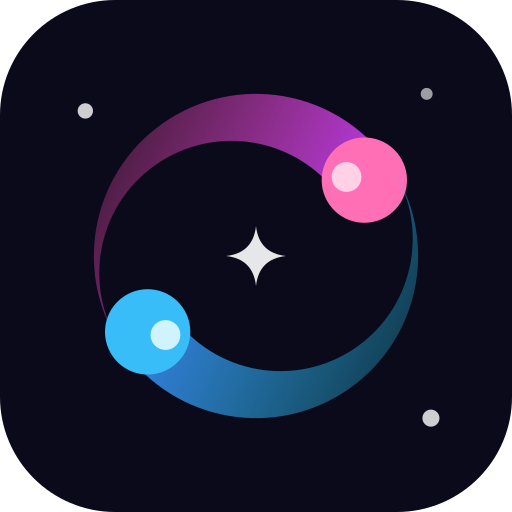

# Orbite

**Un accueil façon console de salon pour tes jeux PC et d'émulateur, en plein écran et entièrement à la manette.**


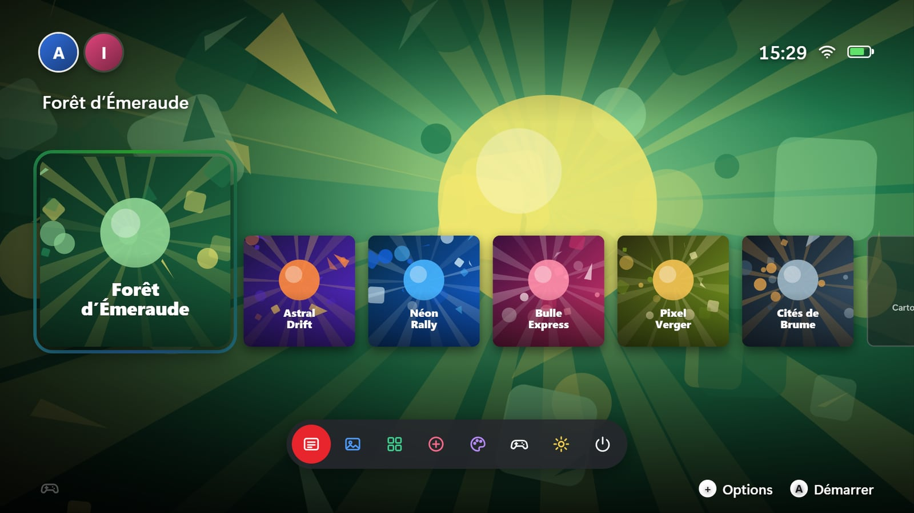

</div>

Orbite démarre **tes propres jeux** : des jeux PC (un programme `.exe`) et des jeux lancés par un émulateur. Il ne contient aucun jeu, firmware, clé ni ROM. La capture ci-dessus et la galerie « Captures » montrent les jeux de démonstration du mode développeur (titres inventés, visuels générés) ; la section « Avec une vraie bibliothèque » montre le lanceur rempli.

Inspiré d'un projet open source de [FireXcorn](https://github.com/FireXcorn) (licence MIT) ; le code de ce dépôt est écrit de zéro.

## Ce qu'il fait

- **Accueil « image du jeu »** : grande image de fond en fondu, rangée de jaquettes avec un contour animé qui prend la couleur de la jaquette, horloge, Wi-Fi et batterie.
- **Tout à la manette** (ou au clavier) : navigation, sons d'interface, vibration, clavier virtuel pour écrire.
- **Jeux PC et émulateurs** : un émulateur se décrit par un petit profil JSON. Écran noir pendant le chargement, détection du moment où le jeu est prêt, titre et icône de la fenêtre remplacés par ceux du jeu.
- **Fiche de chaque jeu** : temps de jeu par profil, dernière session, arguments de lancement, images.
- **Images en grand** : jaquettes en 1024 px et images de fond jusqu'en 4K (3840×2160), choisies depuis tes fichiers.
- **Profils et thèmes** : plusieurs joueurs, cinq thèmes fournis, thèmes personnels avec fond d'écran, importables et exportables.
- **Aucune édition de fichier obligatoire** : tout se règle depuis l'application.

## Captures

<p>
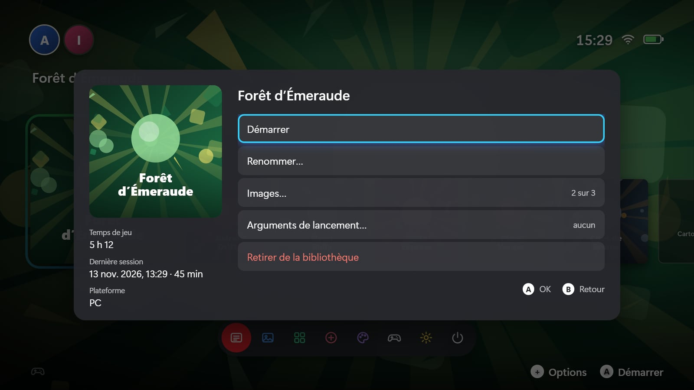
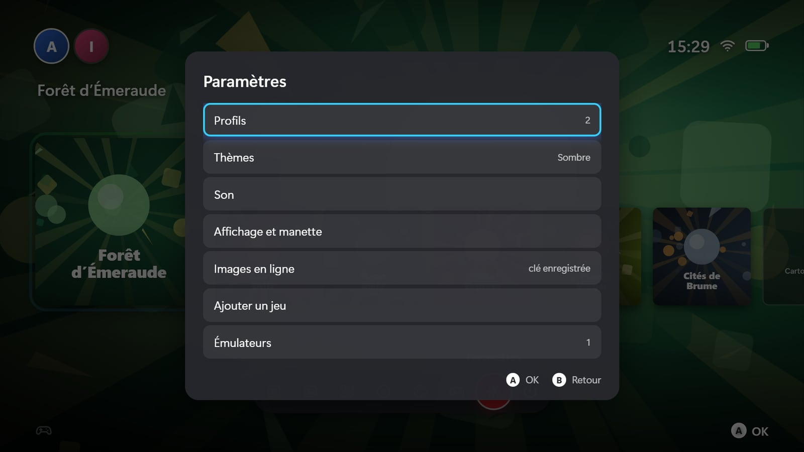
</p>

**À gauche**, la fiche d'un jeu (temps de jeu, dernière session, options). **À droite**, les paramètres.

<p align="center">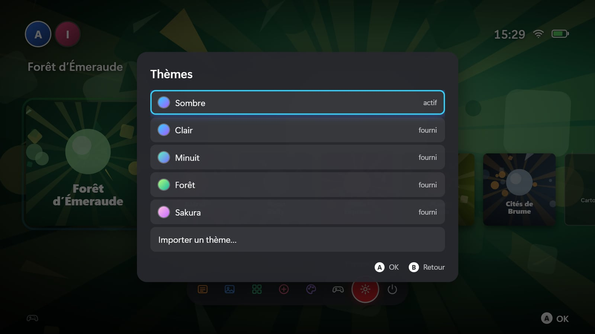<br><b>Le choix du thème</b></p>

<p align="center">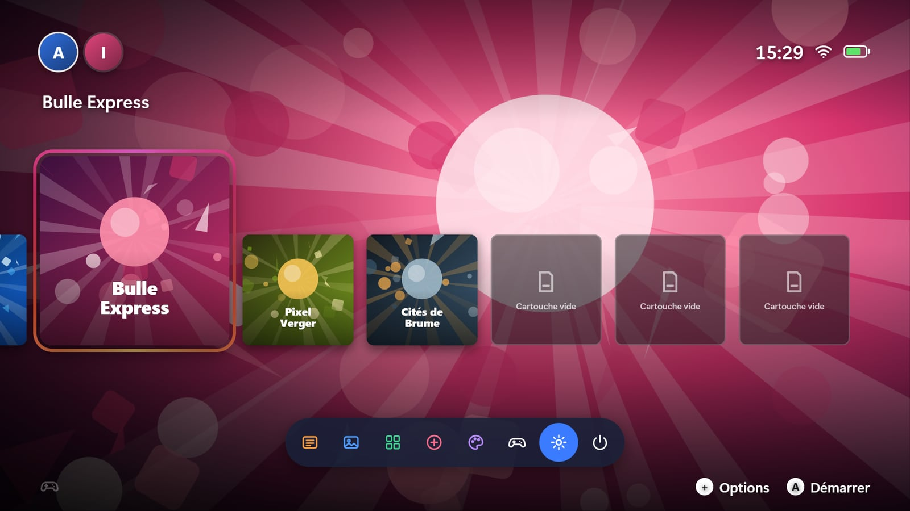<br><b>Le thème Minuit</b></p>

## Avec une vraie bibliothèque

Une fois les jeux ajoutés et leurs images choisies, l'image du jeu sélectionné prend tout l'écran en fond, en 4K, et le contour de sélection prend la couleur de sa jaquette.

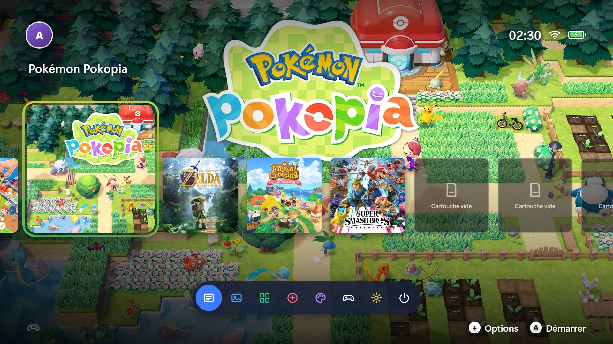

<p>
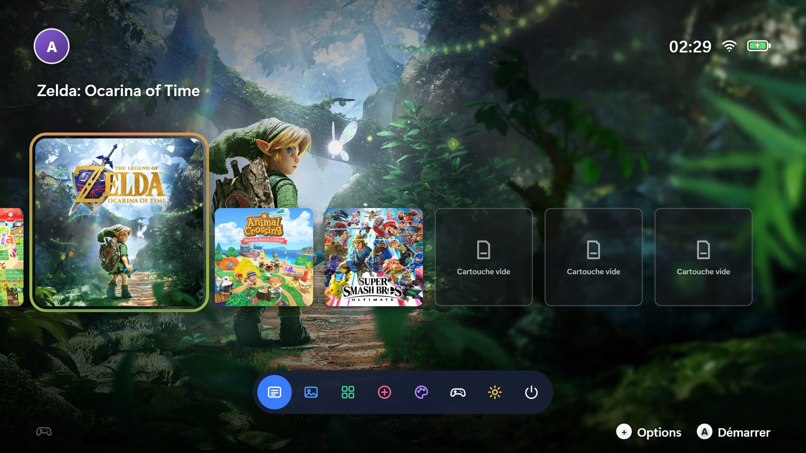
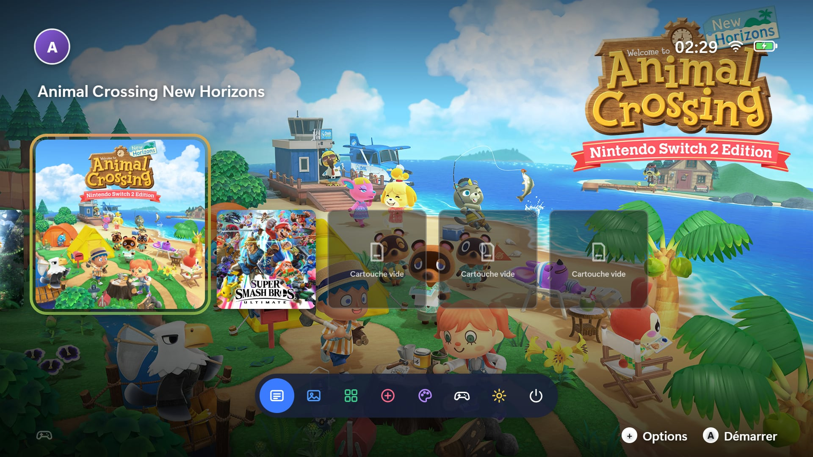
</p>

<p align="center">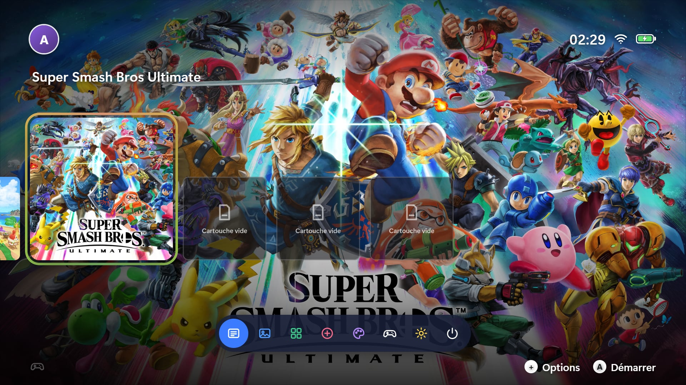</p>

Le contour de sélection change de couleur avec chaque jaquette. La fiche du jeu montre le temps de jeu, la dernière session et l'émulateur utilisé :

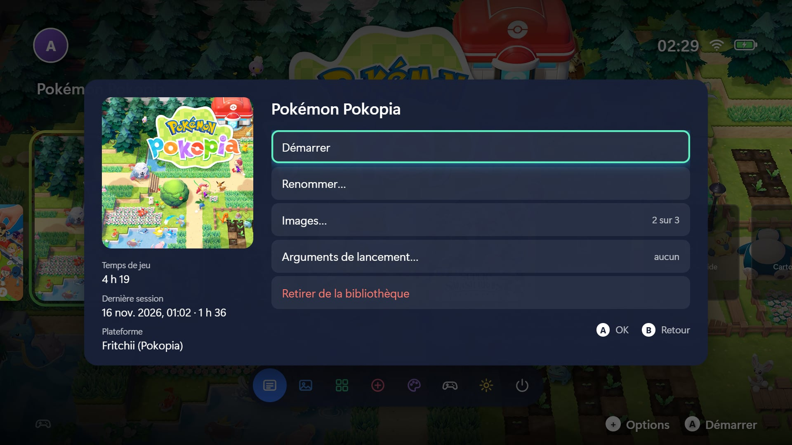

<sub>Les jeux, jaquettes et images de fond de cette section appartiennent à leurs éditeurs. Ils ne sont pas fournis avec le lanceur : chaque joueur ajoute ses propres jeux et choisit ses images.</sub>

## Installation

Il faut [Node.js](https://nodejs.org) (testé avec la version 24).

```bash
npm install
```

npm 11 bloque les scripts d'installation. Deux commandes à lancer une fois après `npm install` :

```bash
npm rebuild koffi
```

```bash
node node_modules/electron/install.js
```

Ensuite, au choix :

| Commande | Effet |
| --- | --- |
| `npm run dev` | Lance l'application en mode développement. |
| `npm run dist` | Construit `dist/win-unpacked/Orbite.exe` (pas d'installateur). |
| `npm run typecheck` | Vérifie les types TypeScript. |
| `npm test` | Lance les tests. |

Pour utiliser le lanceur au quotidien, construis-le avec `npm run dist`, puis lance `Orbite.exe`. Le dossier `dist/win-unpacked` se copie tel quel où tu veux.

## Ajouter un jeu

Tout se fait dans l'application, sans toucher à un fichier.

1. Va sur une case « Cartouche vide » et valide (A), ou choisis le raccourci **+** de la barre du bas.
2. Choisis le type d'ajout :
   - **Jeu PC** : choisis le programme `.exe` du jeu.
   - **Jeu sur émulateur** : indique l'émulateur (la première fois), puis le fichier du jeu.
   - **Importer un dossier** : le lanceur liste les jeux trouvés, tu coches ceux à ajouter.
3. Sur le jeu, ouvre sa fiche avec **+** ou **Y** pour le renommer, lui donner des images ou des arguments de lancement, ou le retirer.

Retirer un jeu l'enlève du lanceur ; ses fichiers sur le disque ne sont pas touchés.

### Images des jeux

Dans la fiche d'un jeu, « Images… » permet de choisir, depuis un fichier de ton disque :

- **la jaquette** : une image carrée de préférence, gardée en 1024 px ;
- **l'image de fond** : en 16:9, gardée jusqu'en 4K (3840×2160) ;
- **le logo** : à fond transparent de préférence, affiché pendant qu'un jeu tourne.

Les images sont converties en WebP et rangées dans le dossier `media` du lanceur ; le fichier d'origine n'est pas modifié.

## Ajouter un émulateur

Un émulateur est décrit par un petit fichier JSON, un « profil ». Le profil de Fritchii est fourni. Pour un autre émulateur, crée un fichier dans `%APPDATA%\Orbite\emulators\` ; il est lu au démarrage. Un profil qui porte le même `id` qu'un profil fourni le remplace.

Exemple, le profil de Fritchii (`resources/emulators/fritchii.json`) :

```json
{
  "id": "fritchii",
  "name": "Fritchii",
  "exeNames": ["lichii.exe"],
  "ignoreDirs": ["update-old"],
  "args": ["-f", "-g", "{game}"],
  "gameExtensions": ["nup", "nsp", "xci"],
  "ready": {
    "log": {
      "file": "{emuDir}\\user\\log\\eden_log.txt",
      "pattern": "LoadKept: Precompiled fast path|Service\\.NVDRV <|maxwell_3d\\.cpp"
    },
    "title": "(\\|[^|]+){3,}",
    "progress": "Precompiled pipelines: (\\d+) of (\\d+) done",
    "settleMs": 2500
  },
  "dialogs": [{ "match": "recommended settings", "answer": "yes" }]
}
```

| Champ | Rôle |
| --- | --- |
| `id` | Identifiant : minuscules, chiffres et tirets. |
| `name` | Nom affiché. |
| `exeNames` | Noms acceptés pour le programme de l'émulateur. |
| `ignoreDirs` | Dossiers dont le programme ne doit jamais être pris (ici, l'ancienne version gardée par une mise à jour). |
| `args` | Arguments de lancement. `{game}` est remplacé par le fichier du jeu, `{emuDir}` par le dossier de l'émulateur. Les chemins avec espaces ou accents passent sans guillemets à ajouter. |
| `gameExtensions` | Extensions proposées à l'import d'un dossier. |
| `ready.log` | Fichier journal de l'émulateur et motif qui signale que le jeu tourne. C'est le signal le plus fiable. |
| `ready.title` | Motif sur le titre de la fenêtre, utilisé si l'émulateur n'écrit pas de journal. |
| `ready.progress` | Motif d'avancement lu dans le journal (groupe 1 = fait, groupe 2 = total), pour la barre de chargement. |
| `ready.settleMs` | Attente après le signal « prêt » avant de montrer le jeu. |
| `dialogs` | Fenêtres de l'émulateur auxquelles répondre automatiquement (`yes`, `no` ou `ok`). |

Seuls `id`, `name`, `exeNames` et `args` sont obligatoires. Sans `ready`, le jeu est montré dès que sa fenêtre existe.

Pendant le chargement, le lanceur affiche un écran noir, puis montre le jeu quand il est prêt. Le titre et l'icône de la fenêtre de l'émulateur sont remplacés par ceux du jeu.

## Raccourcis

| Action | Manette | Clavier |
| --- | --- | --- |
| Se déplacer | Croix ou stick gauche | Flèches |
| Valider, démarrer | A | Entrée |
| Retour | B | Échap ou Retour arrière |
| Fiche du jeu | Y ou + (Start) | Suppr ou Tab |
| Plein écran | | F11 |

Pendant un jeu :

| Action | Raccourci |
| --- | --- |
| Quitter le jeu et revenir au lanceur | Back + Start maintenus 2 secondes, ou Ctrl+Alt+Q |
| Montrer le jeu pendant le chargement | B maintenu 1 seconde |
| Arrêter le jeu depuis le lanceur | B |

Dans Paramètres > Affichage et manette, « Inverser A et B » échange valider et retour.

## Où sont mes données

Tout est dans `%APPDATA%\Orbite\` :

| Fichier ou dossier | Contenu |
| --- | --- |
| `config.json` | Réglages, profils, emplacement des émulateurs. |
| `library.json` | Les jeux. |
| `stats.json` | Temps de jeu par profil et dernières sessions. |
| `emulators\` | Tes profils d'émulateur. |
| `themes\` | Tes thèmes (un dossier par thème, avec `theme.json` et le fond d'écran). |
| `media\` | Les images, converties en WebP. |
| `launcher.log` | Le journal du lanceur. |

Chaque fichier JSON a une copie de secours `.bak`. Un fichier illisible est mis de côté sous le nom `.casse-<date>` et le lanceur repart de la copie de secours ou des valeurs par défaut.

## Dépannage

**L'application ne démarre pas après `npm install`.** Lance les deux commandes de la section Installation (`npm rebuild koffi` et `node node_modules/electron/install.js`).

**Le jeu reste sur l'écran noir.** Maintiens B une seconde pour voir la fenêtre de l'émulateur : elle attend peut-être une réponse. Si le jeu tourne déjà, le motif `ready.log` du profil ne correspond pas au journal de ta version de l'émulateur. Regarde `launcher.log` et le journal de l'émulateur, puis ajuste le motif dans une copie du profil placée dans `%APPDATA%\Orbite\emulators\`.

**Le premier lancement d'un jeu est très long.** L'émulateur prépare ses shaders. La barre de progression avance tant qu'il travaille ; les lancements suivants sont rapides.

**« Émulateur introuvable ».** Le programme a été déplacé. Paramètres > Émulateurs, puis choisis l'émulateur pour indiquer son nouvel emplacement. Ne choisis pas le programme du dossier `update-old`.

**Une tuile est grisée.** Le programme ou le fichier du jeu n'est plus à sa place. Remets-le, ou retire le jeu et ajoute-le de nouveau.

**L'icône Wi-Fi ne montre pas la force du signal.** Windows ne donne ce chiffre que si l'accès à la localisation est activé. Sans lui, l'icône indique seulement que le Wi-Fi est connecté.

**La manette ne réagit pas.** Appuie sur un bouton : Windows ne signale une manette qu'après une première pression. L'icône de manette en bas à gauche s'allume quand elle est reconnue.

**« Démarrer avec Windows » est refusé.** Ce réglage ne fonctionne que dans l'application construite (`npm run dist`), pas avec `npm run dev`.

**Un jeu lancé par un autre lanceur (Steam, par exemple) n'est pas suivi.** Le lanceur suit le programme qu'il démarre et ses programmes enfants. Ajoute directement le `.exe` du jeu quand c'est possible.

## Licence

MIT.
